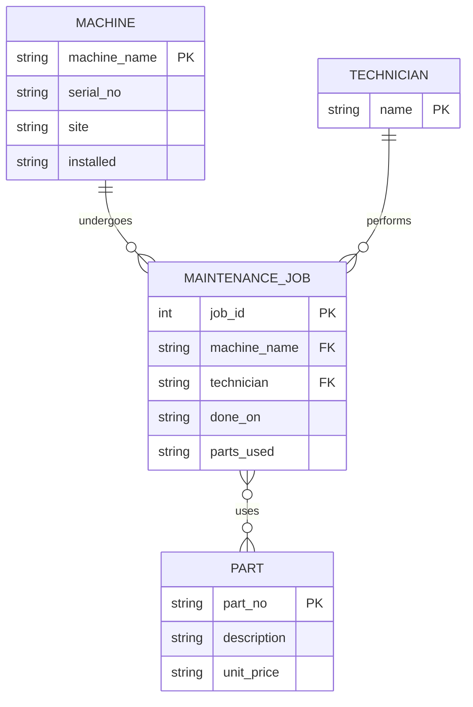

### Task 1: Reconstruct the ER model

#### 1. Entities, Attributes, and Intended Primary Keys
*   **Machine**
    *   **Attributes:** `machine_name`, `serial_no`, `site`, `installed`
    *   **Intended Primary Key:** `machine_name` (used as reference in jobs table)
*   **Part**
    *   **Attributes:** `part_no`, `description`, `unit_price`
    *   **Intended Primary Key:** `part_no`
*   **MaintenanceJob**
    *   **Attributes:** `job_id`, `machine_name`, `technician`, `done_on`, `parts_used`
    *   **Intended Primary Key:** `job_id`
*   **Technician** *(Hidden as a text column, but represents a distinct real-world entity)*
    *   **Attributes:** `name` 
    *   **Intended Primary Key:** `name`

#### 2. ER Diagram (Mermaid)

### Task 2: Integrity Defects

-- Defect 1: orphan maintenance jobs (machine_name not in machine)
SELECT m.job_id, m.machine_name
FROM maint_job m
LEFT JOIN machine x ON m.machine_name = x.machine_name
WHERE x.machine_name IS NULL;
Result: 3|cnc-05
Production Impact: An orphan job cannot be attributed to a valid machine, meaning maintenance costs and labor are lost or assigned to non-existent equipment.

-- Defect 2: duplicate natural keys in part
SELECT part_no, COUNT(*) AS copies
FROM part GROUP BY part_no HAVING COUNT(*) > 1;
Result: P-1003|2
Production Impact: Duplicate part numbers corrupt inventory tracking, potentially causing the purchasing department to double-order parts or report inaccurate stock levels.

-- Defect 3: unit_price stored as text — a numeric comparison fails silently
SELECT part_no, unit_price FROM part WHERE unit_price < '15';   -- 'text ordering', not money!
Result:P-1001|12.50P-1002|48.00
Production Impact: Text-based alphabetical ordering causes numeric comparisons to fail silently (e.g., the system thinks '4' is less than '15'), resulting in incorrect financial calculations and faulty invoices.

-- Defect 4: installed dates that are not dates
SELECT machine_name, installed FROM machine
WHERE installed NOT GLOB '[0-9][0-9][0-9][0-9]-[0-9][0-9]-[0-9][0-9]';
Result: RANDOM-NAME|unknown
Production Impact: Storing non-date strings like 'unknown' in a date field will crash automated scheduling scripts and invalidate machine depreciation reporting.

-- Defect 5: the m:n list only "joins" when it holds exactly one part
SELECT j.job_id, p.description
FROM maint_job j
JOIN part p ON p.part_no = j.parts_used;   -- the list is not a key
-- Watch what happens: job 2 ('P-1003') and job 3 ('P-1001') match, but job 1
-- ('P-1001,P-1002') silently disappears. A naive join on the list loses every
-- multi-part job — and reports success while doing it. That silence is the defect.
Result:2|Coolant filter3|Ball bearing 6203
Production Impact: A naive join on a comma-separated list silently drops jobs with multiple parts (like Job 1), making complex maintenance work completely invisible in cost and part-usage analysis.