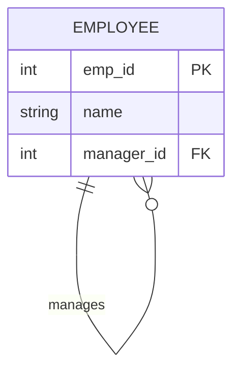

# Task 5: Mermaid ER Diagrams & Concept Critiques

## 1. Collect Curiosities (Good, Strange, Confusing)

### The Good: The Classic Junction (Associative Entity)
**What makes it good:** It perfectly visualizes how a Many-to-Many relationship (Students to Courses) must be physically resolved in a database using a junction table (`ENROLLMENT`). It bridges conceptual design with physical reality.
```mermaid
erDiagram
STUDENT ||--o{ ENROLLMENT : "registers"}
COURSE ||--o{ ENROLLMENT : "contains"}
STUDENT {
    int student_id PK
    string name
}
COURSE {
    int course_id PK
    string title
}
ENROLLMENT {
    int student_id PK, FK
    int course_id PK, FK
    date enrolled_on
}
```
### The Strange: Recursive Relationship
**What makes it strange:** An entity pointing to itself. It looks like an infinite loop, but it is the standard way to model organizational hierarchies (an Employee is managed by another Employee).


### The Confusing/Wrong: The Forced Ternary
**What makes it confusing:** Mermaid `erDiagram` only supports binary relationships (connecting two boxes). When people try to model a Ternary relationship (Supplier provides Part to Project) without a central junction table, they often draw a triangle of relationships. This implies independent connections rather than a single unified transaction.

```mermaid
erDiagram
SUPPLIER }o--o{ PART : "supplies"
PART }o--o{ PROJECT : "used_in"
PROJECT }o--o{ SUPPLIER : "buys_from"}
```
## 2. Schema ↔ Diagram AI Round-Trip

**Findings from the AI translation experiment:**
*   **Schema → Diagram:** The LLM successfully read the `CREATE TABLE` statements and drew the Mermaid diagram accurately. However, I had to verify the cardinalities using `COUNT` queries because the LLM assumed `1:n` for foreign keys without checking if `UNIQUE` constraints forced them to be `1:1`.
*   **Diagram → Schema:** When translating a plain Mermaid diagram back to SQL, the LLM "hallucinated" or invented sensible defaults. It automatically assigned data types (guessing `VARCHAR(255)` for strings), added `ON DELETE CASCADE` rules that weren't in the diagram, and assumed auto-incrementing integers for primary keys. The physical constraints survived, but the business logic was invented.

## 3. Cardinality Overuse
The textbook example stating a car has a "1:4" relationship with wheels is a dangerous misrepresentation of cardinality. Real-world edge cases break this instantly: a car might have a spare tire in the trunk (5 wheels), be towing a trailer (6+ wheels), or be a three-wheeled Reliant Robin. "Exactly 4" is a business validation rule (a `CHECK` constraint), not a structural database cardinality. Genuine physical database cardinality only dictates whether a relationship is `1:1`, `1:n`, or `m:n`. 

## 4. Inheritance Overuse
**The Vehicle Hierarchy:** If we model a base `Vehicle` table branching into `Car` and `Truck` tables, we fall into the inheritance trap. 90% of queries simply need the vehicle's license plate, owner, and current location. Joining multiple tables just to read basic data is massive over-engineering. 
**When it explodes:** Inheritance completely breaks down when categories overlap. If you model a `Person` base table with `Customer`, `Employee`, and `Student` child tables, what happens when a University Student is hired as a Campus Employee and buys a book as a Customer? They end up scattered across four tables. A single table with boolean flags (`is_student`, `is_employee`) or a simple `type` column is vastly superior and more performant than forced SQL inheritance.