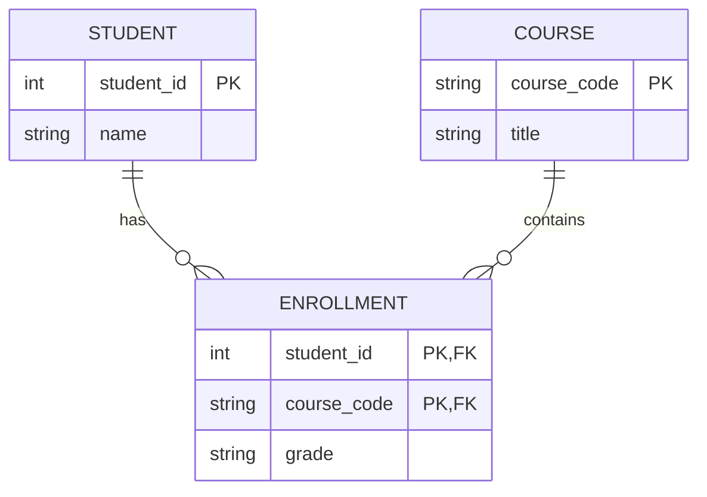
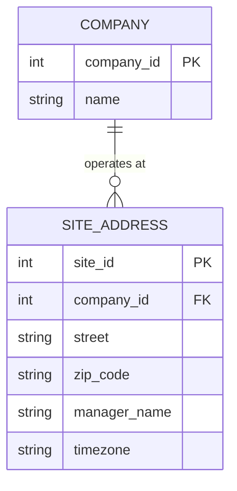

# Module 2 Study Log: From Rows to Meaning

**Note:** As communicated, I completed this study log independently due to being out of town during the live pod session, though I have synced asynchronously with my pod mates on their findings.

### 1. References Used
* **Wikipedia: Entity–relationship model:** Taught me the fundamental distinction between an entity (a standalone object like a `Machine`) and an attribute (a property of that object, like `installed` date).
* **SQLite Foreign Key Documentation (sqlite.org):** Clarified the concept that SQLite does not enforce foreign keys by default to maintain backwards compatibility, meaning legacy schemas easily accumulate orphan rows if constraints aren't explicitly turned on.
* **Wikipedia: First Normal Form (1NF):** Provided the clearest explanation of "atomic values" and why storing arrays or lists in a single column breaks relational algebra.

### 2. Things Googled
* **"What is 1NF in databases?"** -> Found that First Normal Form requires atomic values per column (no comma-separated lists). Source: Wikipedia.
* **"Surrogate key vs Natural key"** -> Found that surrogate keys are synthetic, system-generated IDs (like an auto-incrementing integer), while natural keys exist in the real world (like a machine serial number). Source: Wikipedia.
* **"Crow's foot notation examples"** -> Found visual guides on how to draw the fork (many) and the double dash (exactly one) on relationship lines. Source: diagrams.net documentation.

### 3. Remarkable Things
* **Aha Moment (Orphan Rows):** The `maint_job` table uses `machine_name` to link jobs to machines. However, because there is no foreign key constraint, Job 3 is assigned to `cnc-05`—a machine that does not even exist in the `machine` table!
* **Surprise (1NF Violation):** The `parts_used` column stores a string like `'P-1001,P-1002'`. This makes it incredibly difficult to write a simple SQL query to find out how many times a specific part was used across all jobs. 
* **Counterexample (Natural Key Failure):** The `part_no` in the `part` table looks like a natural primary key, but because it lacks a `UNIQUE` constraint, 'P-1003' was inserted twice with the same description. 

### 4. LLM Q&A

**Prompt 1:** *"A column holds a comma-separated list: `parts_used = 'P-1001,P-1002'`. Why does that violate 1NF, and what would the corrected schema look like?"*
* **Summary:** The LLM explained that 1NF requires "atomic" (indivisible) values. A list prevents efficient joining or searching. The fix is removing the column and creating a junction table (e.g., `job_part`) with one row per part per job.
* **Verification:** I verified this by looking at `legacy.db`. Job 1 has `P-1001,P-1002`. A standard `JOIN` on this column fails completely.

**Prompt 2:** *"Give three real-world incidents caused by missing foreign keys or orphan rows."*
* **Summary:** The LLM provided scenarios such as billing systems charging deleted customer accounts, maintenance logs attached to retired equipment, and e-commerce orders pointing to non-existent inventory IDs.
* **Verification:** This perfectly matches our `legacy.db` data where a maintenance technician performed work on `cnc-05`, effectively charging maintenance time to a phantom machine.

### 5. Two Best ER Sketches Found

**Sketch 1: The Many-to-Many Junction Table**
* **Source:** Wikipedia / General DB Tutorials

* **What I learned:** This diagram clearly showed that an M:N relationship isn't drawn as a direct line in a physical schema. Instead, it showed a junction table in the middle, with two `1:N` relationships pointing *inward* toward the junction table. This perfectly visualizes how we need to fix the `parts_used` column.

**Sketch 2: Attribute vs. Entity Breakdown**
* **Source:** diagrams.net ER templates

* **What I learned:** It showed when an attribute becomes too complex and needs to become its own entity. If a property (like a 'Site' or 'Address') starts needing its own properties (zip code, manager, timezone), it must be broken out into a separate entity rather than staying as a text column.