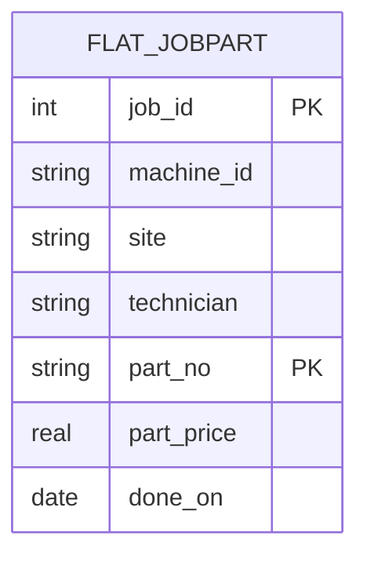
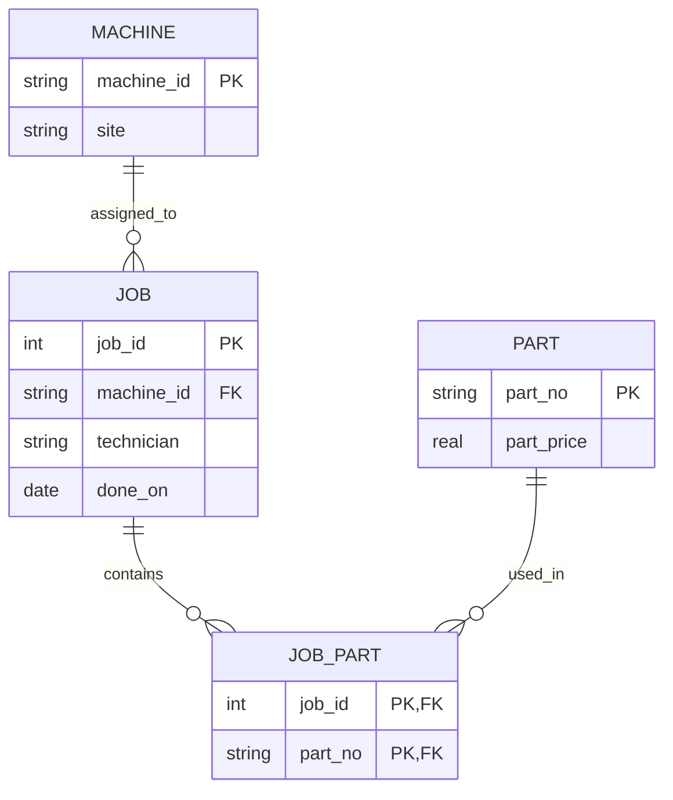

# Functional Dependencies, Normal Forms, and Anomalies

## Starting relation and domain assumptions

The flat relation is `flat_jobpart(job_id, machine_id, site, technician, part_no, part_price, done_on)`. One row represents one part used by one maintenance job. The domain assumptions for this exercise are: a job uses one machine, has one primary technician and one completion date; a machine belongs to one site; and a part number identifies one current unit price. A job cannot list the same part twice in this simplified exercise.

## Functional dependencies and candidate key

An FD `X -> Y` means that two valid rows agreeing on `X` must agree on `Y`.

| Dependency | Status | Reason |
|---|---|---|
| `job_id -> machine_id, technician, done_on` | Domain rule | Each job has one machine, primary technician, and completion date. |
| `machine_id -> site` | Domain rule | A physical machine has one current site. |
| `part_no -> part_price` | Domain rule for this exercise | A part number has one current unit price. A real price history would need an effective date or a separate price entity. |
| `(job_id, part_no) -> all attributes` | Candidate-key dependency | The pair identifies a job-part line and determines the job facts and part facts attached to that line. |
| `technician -> site` | Merely observed in the five sample rows | All shown rows place `tech-0` at Gütersloh, but the domain allows a technician to work at another site. This is not assumed to be an FD. |

`job_id` alone is not a key because one job has several part rows. `part_no` alone is not a key because the same part can be used by different jobs. Together, `(job_id, part_no)` identifies one row under the stated rule that a part appears at most once per job. Neither attribute can be removed while retaining uniqueness, so the key is minimal and is a candidate key. The generated dataset follows this rule; the primary key on `job_part` enforces it in the normalized schema.

## ER sketches

The first diagram shows the original single relation. Repeated job and part facts sit on every job-part row. The second diagram separates those facts into entities and uses `job_part` for the many-to-many relationship.

### Original flat design



### Normalized design



## 1NF, 2NF, and 3NF in this exercise

**1NF — one atomic value per cell.** `flat_jobpart` stores one `part_no` and one `part_price` per row; it does not store a comma-separated `parts_used` list. It is in 1NF when each job-part occurrence occupies its own row. This removes the repeating-list problem: individual parts can be filtered, joined, and constrained as values.

**2NF — no non-key attribute depends on only part of a composite key.** The flat relation's candidate key is `(job_id, part_no)`. `job_id -> machine_id, technician, done_on` and `part_no -> part_price` are partial dependencies because each right-hand value needs only one component of the pair. Storing those values on every line repeats job and part facts and lets copies drift. The decomposition into `job`, `part`, and `job_part` puts each fact with the key that determines it; `job_part` retains only the association.

**3NF — no non-key attribute depends transitively on a key through another non-key attribute.** After the 2NF split, putting `site` on `job` would still create `job_id -> machine_id -> site`: `machine_id` determines `site`, and `machine_id` is not the job key. The 3NF design stores `site` once in `machine`; `job` refers to that machine. Changing a machine's site is then one source-row update rather than an update to every job-part row.

In summary, a **partial dependency** uses only a proper subset of a composite key; a **transitive dependency** reaches an attribute through another non-key attribute. The former is removed by the 2NF decomposition; the latter by separating `machine` in the 3NF decomposition.

## Reproducible anomaly demonstrations

Run this block in a fresh SQLite connection. The five rows are the small relation from the course exercise.

```sql
CREATE TABLE flat5 (
  job_id INTEGER NOT NULL,
  machine_id TEXT NOT NULL,
  site TEXT NOT NULL,
  technician TEXT NOT NULL,
  part_no TEXT NOT NULL,
  part_price REAL NOT NULL,
  PRIMARY KEY (job_id, part_no)
);
INSERT INTO flat5 VALUES
  (1,'cnc-01','Gütersloh','tech-0','P-0001',6.00),
  (1,'cnc-01','Gütersloh','tech-0','P-0002',7.00),
  (2,'cnc-02','Gütersloh','tech-1','P-0001',6.00),
  (2,'cnc-02','Gütersloh','tech-1','P-0003',8.50),
  (3,'cnc-01','Gütersloh','tech-0','P-0003',8.50);
```

### Update anomaly

The site fact for `cnc-01` occurs on three rows. Updating only two leaves contradictory copies; updating all three requires locating and changing every copy.

```sql
UPDATE flat5 SET site = 'Bielefeld'
WHERE machine_id = 'cnc-01' AND job_id = 1;
SELECT DISTINCT site FROM flat5 WHERE machine_id = 'cnc-01' ORDER BY site;
-- Result: Bielefeld and Gütersloh; the copies disagree.
```

### Insertion anomaly

The flat relation represents a job-part occurrence, so it has nowhere to store a part that no job has used. This attempted row is rejected because it lacks the job and other mandatory facts; making those columns nullable would permit an incomplete line, not a clean part fact.

```sql
-- Expected constraint error: NOT NULL constraint failed.
INSERT INTO flat5 (job_id, machine_id, site, technician, part_no, part_price)
VALUES (NULL, NULL, NULL, NULL, 'P-0099', 19.99);
```

In the normalized design the independent fact is insertable without inventing a job:

```sql
CREATE TABLE part(part_no TEXT PRIMARY KEY, part_price REAL NOT NULL) STRICT;
INSERT INTO part(part_no, part_price) VALUES ('P-0099', 19.99);
```

### Delete anomaly

`P-0002` appears only on job 1. Deleting that job-part row also destroys the only stored copy of the part's price.

```sql
DELETE FROM flat5 WHERE job_id = 1 AND part_no = 'P-0002';
SELECT COUNT(*) AS remaining_rows_for_part
FROM flat5 WHERE part_no = 'P-0002';
-- Result: 0. The flat relation no longer records P-0002 or its price.
```

In the normalized design, deleting an association from `job_part` does not delete the independent row in `part`.
